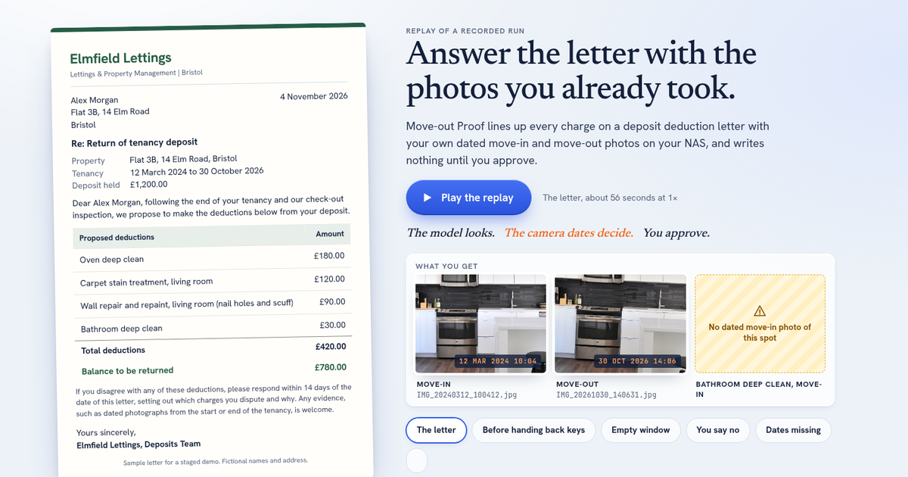

# Move-out Proof

**Your landlord kept part of your deposit. Move-out Proof finds your dated move-in and move-out photos on your UGREEN NAS and lines them up against every charge.**

A Skill for the UGREEN AI NAS assistant, built for the UGREEN Hackathon 2026 on AI NAS.

> The model looks. The camera dates decide. You approve.

**Walkthrough video (2:21):** [youtu.be/NbebQNJHPKs](https://youtu.be/NbebQNJHPKs)

**Watch it run:** [move-out-proof.vercel.app](https://move-out-proof.vercel.app), a replay of recorded emulator runs (no sign-in, no model calls).



## What it does

Tell the assistant your move-in and move-out dates. Move-out Proof:

1. finds the photos taken in each window (capture time from photo metadata),
2. has the on-device vision model name the spot in each photo from a fixed list (kitchen-oven, living-room-carpet, bathroom-tub...), or `unclear`,
3. reads the charges on the landlord's deduction letter,
4. puts the move-in photo and the move-out photo of the same spot beside each charge, with their capture dates, and states every gap ("No dated move-in photo of this spot"),
5. after you approve the exact list, creates an album of the pairs, a `Deposit_Evidence` folder next to the letter (copies, originals untouched) and a charge-by-charge report.

Before you move out, ask "Which parts of the flat have no move-in photo?" to get the spots you still need to photograph.

It never says whether a charge is fair, never invents a photo or a date, and writes nothing before approval.

## The Skill package

[`skill/move-out-proof/`](skill/move-out-proof/) is the package: `SKILL.md` and three references (the spot list, the report format, a user guide). It delegates to four registered experts, using only actions in UGREEN's public capability catalog 2.0.0:

| Step | Expert | Catalog actions |
|---|---|---|
| Find photos in each window | photo-agent | `ug-photo search-picture` (start/end time), `meta` |
| Name the spot in each photo | photo-agent | `ug-photo vision-vlm` |
| Read the charges | document-agent | `ug-document extract` (contract schema), `qa` |
| Album of the pairs (after approval) | photo-agent | `ug-photo create-album` |
| Evidence folder (after approval) | file-agent | `ug-filesystem mkdir`, `cpmv` (copy) |
| Report (after approval) | knowledge-agent | `ug-knowledge save-text` |

Official check (UGREEN Skill Creation Tool 0.7.3): **static-pass, 0 errors, 0 warnings.**

```text
npm run kit            # download UGREEN's Skill Creation Tool into .kit/
npm run check:skill    # run the official checker; fails on any error or warning
npm run package        # build dist/move-out-proof.zip for upload
```

## Testing without a NAS: the emulator

[`emulator/`](emulator/) runs the real `SKILL.md` on a laptop the way the assistant is described: a main agent that can only `delegate`, and expert agents whose tools are named after the catalog actions above, over a sandboxed copy of a staged demo apartment. Writes go to a sandbox and pass an approval gate. Each run is saved as a trace and checked:

```text
npm test                                              # unit tests (no network)
node emulator/run.mjs emulator/scenarios/letter.json --save   # live run (needs GEMINI_API_KEY in .env.local)
node emulator/check-runs.mjs                          # invariants on every saved run
node emulator/eval-labels.mjs --report                # spot-label accuracy against ground truth
```

Scenarios: `letter` (four charges, one with no move-in photo, one blurry photo), `gap` (before handing back the keys), `empty-window` (no photos in the move-in window), `declined` (the person says no at approval), `no-dates` (dates missing from the request).

Invariants checked on every run: no write before the person approved; every date in the approval rows equals the photo's capture date; every photo exists in the library; no pair mixes two spots; unclear photos are never paired; plus each scenario's own outcome.

The emulator is ours, built from UGREEN's public catalog: it is a rehearsal of the flow, not proof of device behaviour. The real-device run is planned for the finalist session.

## Staged demo apartment

[`fixtures/apartment/`](fixtures/apartment/) is staged: free-licence stock photos from Wikimedia Commons (CC0 and CC BY-SA 4.0), programmatic re-shots for the move-out side, added marks (a carpet stain present at move-in, nail holes at move-out), assigned camera dates, and a fictional letter. Sources and licences: [CREDITS.md](fixtures/apartment/CREDITS.md).

## Limits

- No UGREEN NAS was available for the preliminary round. The emulator is ours, built from the public capability catalog; it rehearses the flow but does not prove device behaviour. The real-device run is planned for the finalist session.
- The demo apartment is staged: stock photos, assigned dates, a fictional letter.
- The Skill needs photos with correct capture dates and finds only what was photographed. Vision notes can be wrong, which is why every row shows both photos for the renter to judge.
- Spot-label accuracy (12 of 12) was measured on the same 12 photos used to tune the prompt.

## How it was built

Built from 6 November 2026, inside the hackathon's build window. AI tools used: Claude Code (planning, code, review) and the UGREEN Skill Creation Tool's checker; the emulator's agents run on Google Gemini models (Gemini 3.5 Flash-Lite and others, via the Gemini API).

## Licence

Code: MIT. Photos: their own licences, listed in `fixtures/apartment/CREDITS.md`.
